# AutoVerse 3D

A native **iOS and Android** app for exploring an original, fictional vehicle — **UrbanX**, a compact urban SUV — in
interactive 3D: showroom, interior explorer, mechanical explorer with exploded views, EV lab, safety lab, customization
studio, learning modules with quizzes, and an AI automotive assistant with an offline fallback.

* **iOS:** Swift 6 · SwiftUI · RealityKit · SwiftData · URLSession async/await · XCTest
* **Android:** Kotlin · Jetpack Compose + Material 3 · Filament · Room · Hilt · Retrofit · Coroutines/Flow · JUnit
* **Shared:** versioned JSON contracts and content, an original procedurally-authored 3D asset (GLB + USDZ), validators,
  and a small Node backend (content, verified asset downloads, AI proxy)

All vehicles are fictional; no manufacturer names, logos, CAD data or paid models are used. See
[ASSET_LICENSING.md](ASSET_LICENSING.md).

## Screenshots

| Showroom (Android) | Paint, doors, lights | Interior hotspots | Mechanical (exploded) |
|---|---|---|---|
| 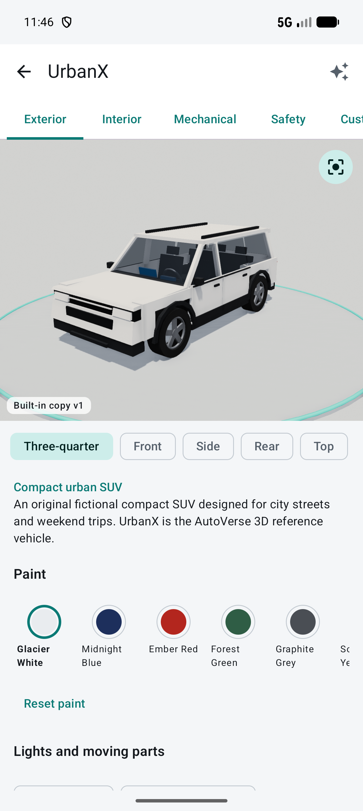 | 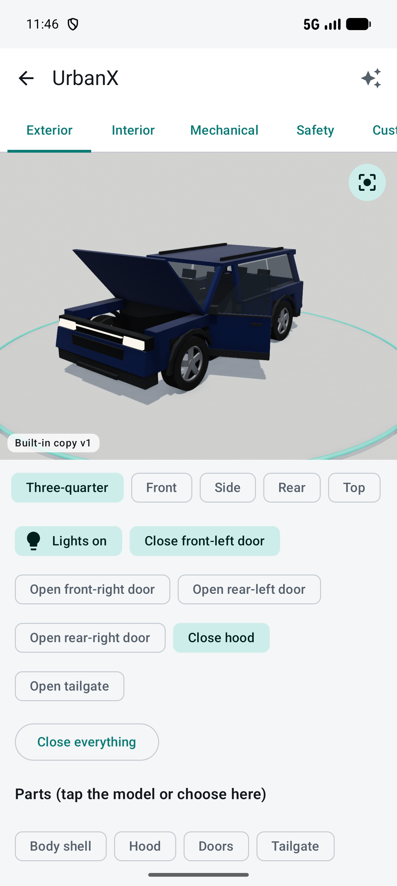 | 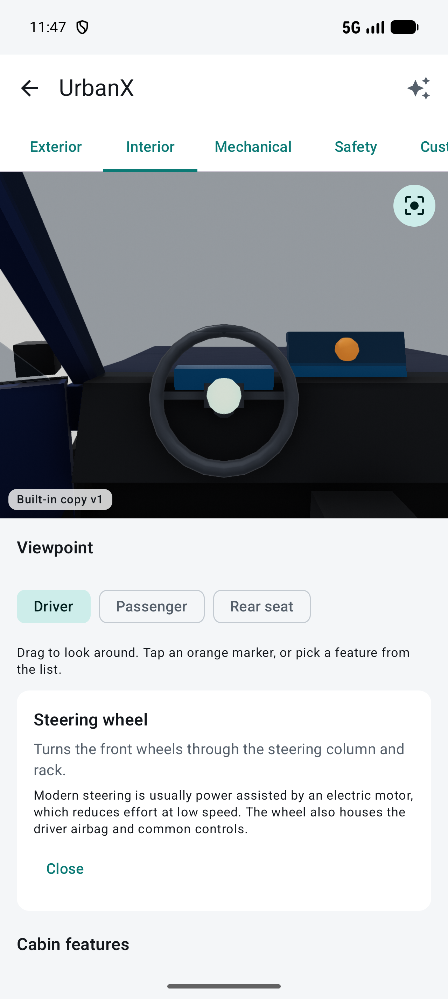 | 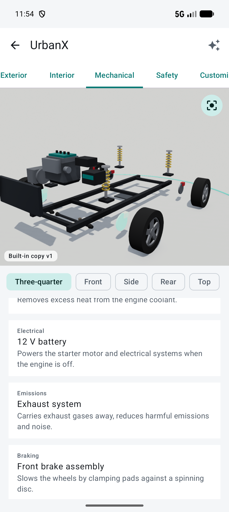 |

| Safety lab | Customization | EV Lab | Offline assistant |
|---|---|---|---|
| 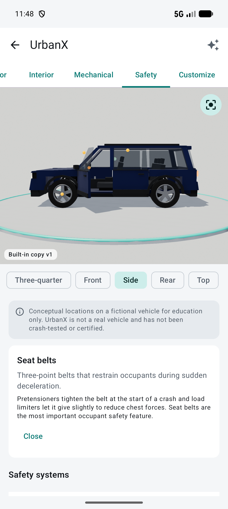 | 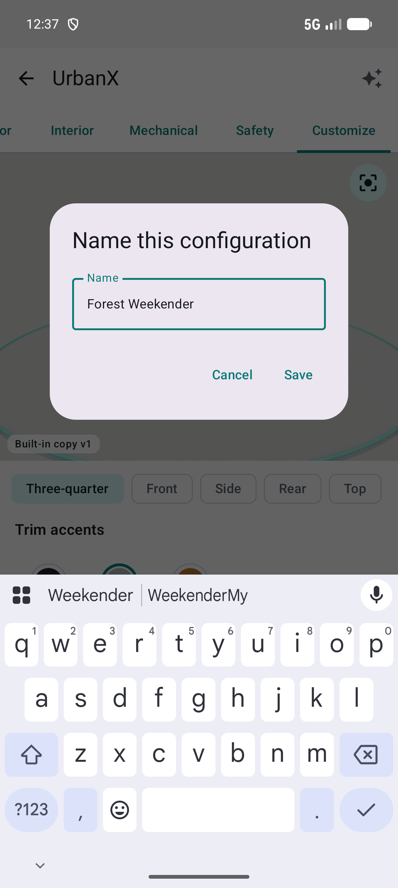 | 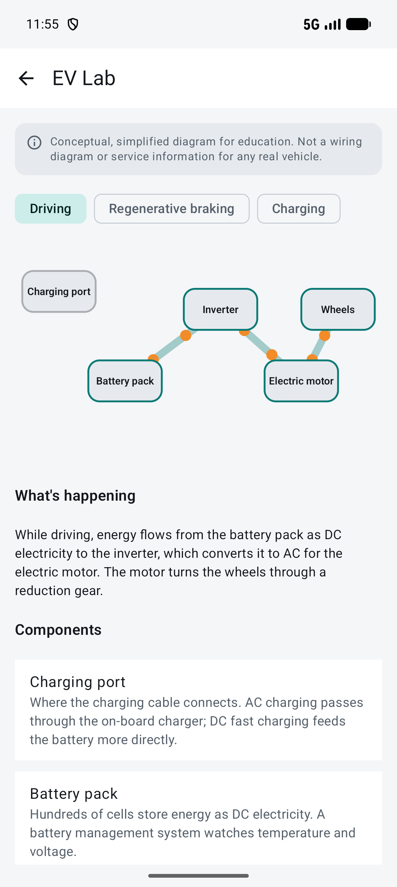 | 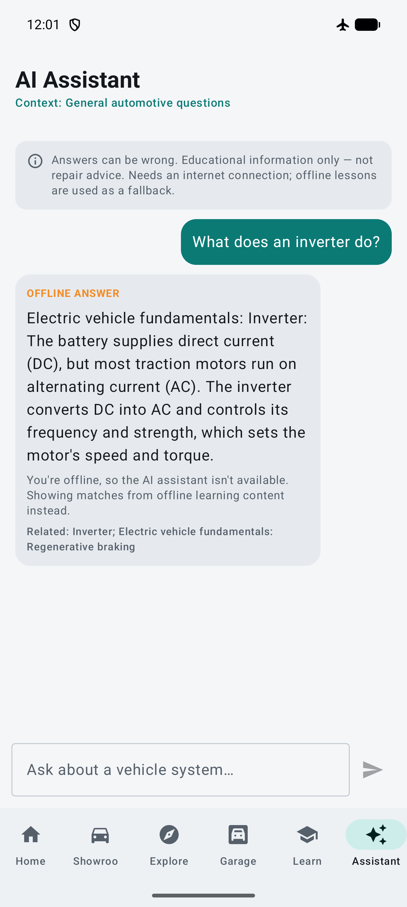 |

| Home (iOS) | Exterior (iOS) | Mechanical (iOS) | Garage + downloaded pack (iOS) |
|---|---|---|---|
| 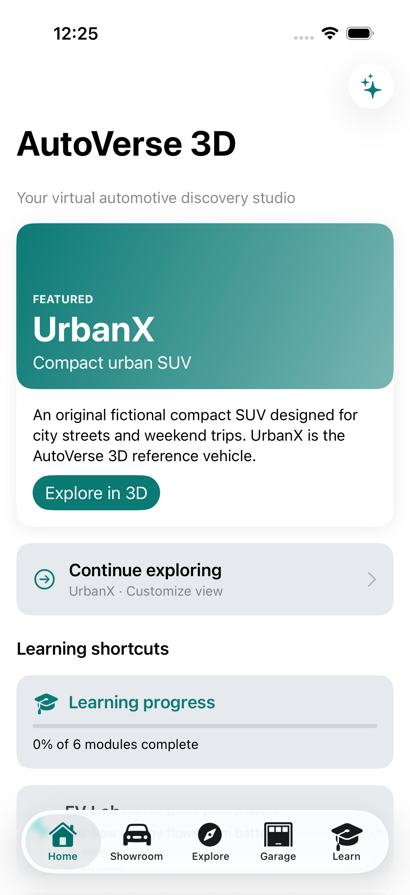 | 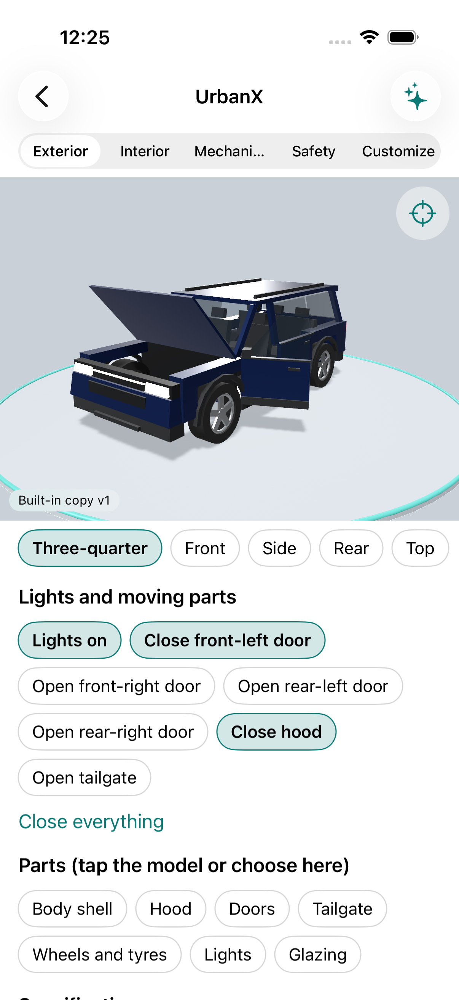 | 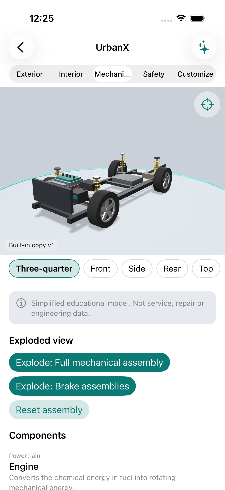 | 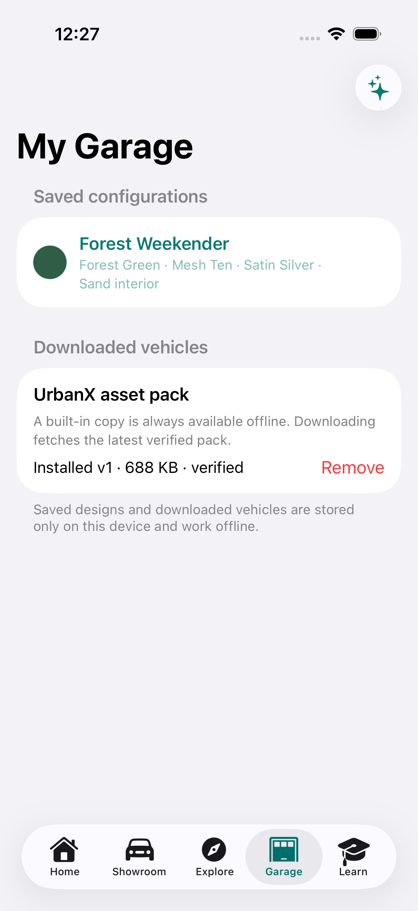 |

| Interior (iOS) | Safety (iOS) | Quiz (iOS) | Assistant (iOS) |
|---|---|---|---|
| 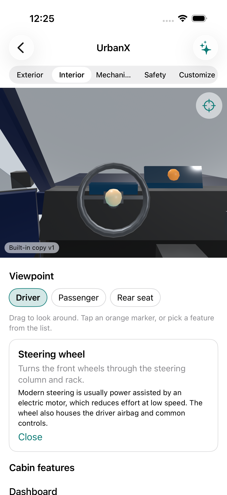 | 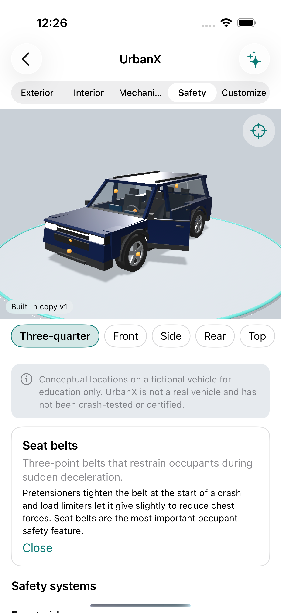 | 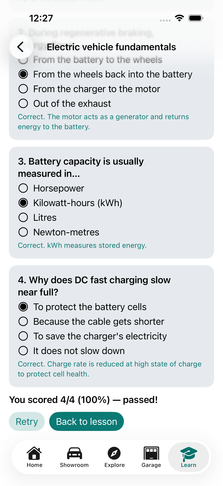 | 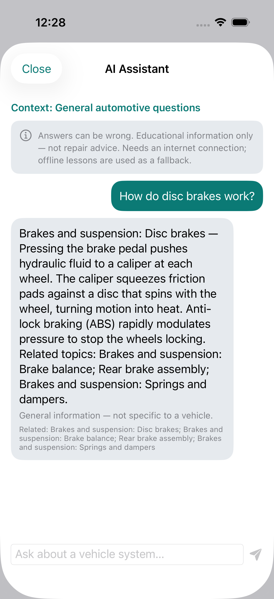 |

All screenshots: [`screenshots/android`](screenshots/android) · [`screenshots/ios`](screenshots/ios).

## Quick start

```bash
# 1. Assets & validation (optional — built assets are committed)
python3 -m venv tools/.venv && tools/.venv/bin/pip install -r tools/requirements.txt
tools/.venv/bin/python tools/validate/validate_assets.py

# 2. Backend (mock AI provider unless ANTHROPIC_API_KEY is set)
cd backend && npm ci && npm start

# 3. Android
cd android && ./gradlew :app:installDebug

# 4. iOS
cd ios && xcodegen generate && open AutoVerse3D.xcodeproj
```

## Repository layout

| Path | Contents |
|---|---|
| `shared/` | JSON schemas, vehicle/component/hotspot/customization/camera data, learning + EV content, design tokens, licence registry |
| `assets/` | UrbanX spec, built GLB/USDZ/scene descriptors, manifests |
| `tools/` | `assetgen` (procedural original asset), `validate` (CI gate), `tests`, `preview` (macOS render) |
| `backend/` | Node API + AI proxy ([API docs](docs/API_DOCUMENTATION.md)) |
| `android/`, `ios/` | Native apps ([Android setup](docs/ANDROID_SETUP.md), [iOS setup](docs/IOS_SETUP.md)) |
| `docs/` | [Plan](docs/IMPLEMENTATION_PLAN.md) · [Status](docs/IMPLEMENTATION_STATUS.md) · [Architecture](docs/ARCHITECTURE.md) · [Asset pipeline](docs/ASSET_PIPELINE.md) · [Data models](docs/DATA_MODELS.md) · [Testing](docs/TESTING_STRATEGY.md) · [Privacy & security](docs/PRIVACY_AND_SECURITY.md) |
| `screenshots/` | Emulator/simulator captures of every module |

Contributing: [CONTRIBUTING.md](CONTRIBUTING.md).

License: [MIT](LICENSE).
